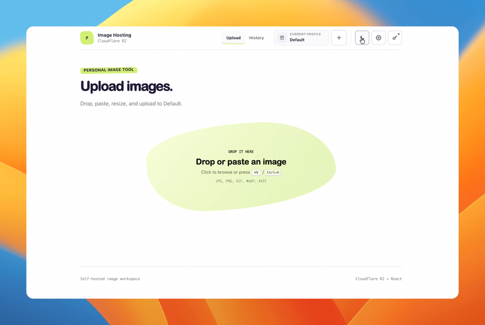

[繁體中文](README.md) | [English](README.en.md)

<p align="center">
  
  <h1 align="center">R2 Image Hosting</h1>
</p>

<p align="center">
  
  
</p>

A small self-hosted image upload tool for blogs, documentation, and Markdown posts.

[Live Demo](https://image.demo.peiwang.dev/)

> **Note:** The demo is for showcase purposes only. Uploaded images are deleted within 7 days.

<p align="center">
  
</p>

## 💡 Why

I kept looking for an image host while writing my blog, and I wanted to own my images instead of relying on a third party. So I built this: drop or paste an image into the page, optimize it in the browser, upload it to my own Cloudflare R2, and copy the Markdown or URL right away. Bucket credentials stay on the server and never reach the browser.

## ✨ Features

- **Upload:** Drop one file or paste with `Command + V` or `Ctrl + V`, and preview it before uploading.
- **Processing confirmation:** Compare dimensions, file sizes, and processing time; use High, Standard, Fast, or custom long-edge, WebP quality, and sharpening settings.
- **Upload result:** Enter a display filename or generate a random eight-character name, then get the image, Markdown, and URL.
- **Profiles:** Switch between R2 buckets and use the in-app helper to prepare a new server-side profile.
- **Tags and search:** Add tags and search images by tag.
- **Gallery and list:** A full-width Masonry gallery loads more as you scroll; the list is easier to read and manage.
- **Edit and delete:** Renaming the display filename does not change the image URL; images can also be deleted from the library.

## 🛠️ How it works

- **Processing in the browser:** Resize, sharpen, and WebP encoding run in a Web Worker with a native Canvas fallback, and no image codec dependency.
- **Single entry point:** One Gateway Worker deploys the Web assets and API together; Contracts holds only the data, limits, and error shapes shared by the two apps.
- **Server-side validation:** The server checks the real file signature instead of trusting the browser's MIME type; SVG is rejected because it may contain scripts.
- **Multiple buckets, no leaked credentials:** Each profile maps to one R2 bucket, configured on the server; Cloudflare Access protects the management API, the Worker verifies the JWT on every request, and it fails closed when the setup is incomplete.
- **CI and monitoring:** GitHub Actions runs `pnpm check` and checks `/health` after deployment; Sentry source maps are deleted before deploy.

## 📊 Benchmark

Measured on 2026-09-06 with 10 Fujifilm X-T30 II JPEGs (6240×3512), MacBook Air (Apple M2, 8 GB), Chromium, High setting (long edge 2048px, WebP 85, Mid sharpening); each image run 3 times, median reported; time covers decode, resize, sharpen, and WebP encode, excluding upload.

- Total size: 70.29 MiB → 1.97 MiB
- Overall saving: 97.20%
- Median processing time per image: 435 ms

## 🧰 Tech Stack

React, TypeScript, Vite | Cloudflare Workers, Cloudflare R2 | Vitest | pnpm workspace | GitHub Actions, Sentry

## 🚀 Quick start

Node.js 22 or newer is required.

```bash
pnpm install
cp .dev.vars.example .dev.vars
cp wrangler.jsonc.example wrangler.jsonc
```

Replace `you@example.com` in `.dev.vars` with your email, then start the app:

```bash
pnpm dev
```

Open [http://127.0.0.1:5173](http://127.0.0.1:5173) in your browser. For configuration, Cloudflare Access, profiles, API, deployment, and security, see [SETUP.en.md](SETUP.en.md).

## 📁 Repository

| Path | Description |
| --- | --- |
| [`apps/web`](apps/web) | React and TypeScript browser interface |
| [`apps/gateway`](apps/gateway) | Gateway Worker: the single public entry point, serving the website and image API |
| [`packages/contracts`](packages/contracts) | Data, limits, and error shapes shared by the two apps |

## 📄 License

MIT. See [LICENSE](LICENSE).
