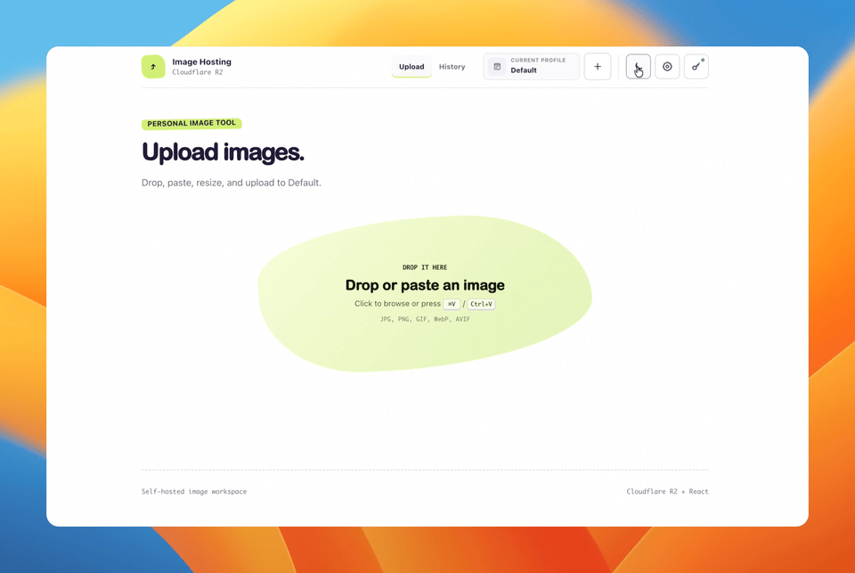

[English](README.md) | [繁體中文](README.zh-TW.md)


<p align="center">
  
  <h1 align="center">R2 Image Hosting</h1>
</p>

<p align="center">
  
  
</p>


A small self-hosted image upload tool for blogs, documentation, and Markdown posts.

[Live Demo](https://image.demo.peiwang.dev/)

> **Note:** The demo is for showcase purposes only. Uploaded images are deleted within 7 days.


- [Features](#features)
- [Tech Stack](#tech-stack)
- [Supported Images](#supported-images)
- [Run Locally](#run-locally)
- [Configuration](#configuration)
- [Profiles](#profiles)
- [API](#api)
- [Security and Privacy](#security-and-privacy)
- [Commands](#commands)
- [CI and deployment](#ci-and-deployment)
- [Deploy](#deploy)
- [License](#license)


Drop or paste an image into the page, optimize it in the browser, upload it to Cloudflare R2, and copy the Markdown or image URL immediately.

<p align="center">
  
</p>


## Features

- **React & TypeScript:** Client app is built by React & TypeScript.
- **Upload:** Drop one file or paste an image with `Command + V` or `Ctrl + V`.
- **Preview:** Check the image before uploading it.
- **Processing confirmation:** Compare dimensions, file sizes, resize percentage, savings, and processing time before uploading.
- **Custom processing:** Use High, Standard, Fast, or custom long-edge, WebP quality, and sharpening settings.
- **Responsive processing:** Resize, sharpen, and encode WebP in a Web Worker when supported, with a native Canvas fallback.
- **Auto rename:** Enter a display filename or generate a random eight-character name.
- **Upload result:** Show the uploaded image, Markdown, and image URL after a successful upload.
- **Profiles:** Switch between R2 buckets and use the in-app setup helper to prepare a new server-side profile without exposing bucket credentials to the browser.
- **GitHub login:** Sign in once through Cloudflare Access and stay signed in for a month. The Worker verifies the Access token on every management API request.
- **Themes:** Use the system theme or choose light/dark mode.
- **Tags:** Add tags and search images by tag.
- **Gallery and list:** Switch from the header between a full-width Masonry gallery with 30 px margins that loads more images as you scroll, or a centered list capped at 900 px for easier reading and management.
- **Edit:** Change the display filename without changing the image URL.
- **Delete:** Remove images from the library.

## Tech Stack

| Technology | Used for |
| --- | --- |
| Cloudflare Workers | Serves the website and image API |
| Cloudflare R2 | Stores uploaded images |
| TypeScript | Worker and API code |
| React, TypeScript, Vite | Browser interface |
| Vitest | Automated tests |

The browser runtime dependencies are React and ReactDOM; image processing uses native browser APIs without a separate image codec dependency.

The pnpm workspace contains only `apps/web`, `apps/gateway`, and `packages/contracts`. The Gateway Worker remains the single public entry point and deploys the Web assets and API together; Contracts contains only data, limits, and error shapes shared by those two apps.

[Image processing benchmark](docs/image-processing-benchmark.md)

## Supported Images

The app accepts JPEG, PNG, GIF, WebP, and AVIF files. The default upload limit is 10 MiB.

The server checks the real file signature instead of trusting the MIME type sent by the browser. SVG is not supported because it may contain executable scripts.

## Run Locally

Node.js 22 or newer is required.

```bash
pnpm install
cp .dev.vars.example .dev.vars
cp wrangler.jsonc.example wrangler.jsonc
```

Replace `you@example.com` in `.dev.vars` with your email, then start the app:

```bash
pnpm dev
```

Open [http://127.0.0.1:5173](http://127.0.0.1:5173) in your browser. Vite proxies API and image requests to the local Worker on port `8787`.

Wrangler uses local R2 storage during development, so local uploads do not change the production bucket.

## Configuration

Local settings are stored in `.dev.vars`:

```dotenv
ACCESS_DEV_EMAIL=you@example.com
ACCESS_TEAM_DOMAIN=
CORS_ORIGINS=http://localhost:3000,https://www.example.com
MAX_UPLOAD_BYTES=10485760
```

- `ACCESS_DEV_EMAIL` signs local requests in as this email, so you can run the app without Cloudflare Access. The Worker accepts it only for requests to `localhost`, `127.0.0.1`, or `[::1]`, and only while `ACCESS_TEAM_DOMAIN` is empty.
- `ACCESS_TEAM_DOMAIN=` clears the production value from `wrangler.jsonc` for local runs. Without it, a configured `wrangler.jsonc` turns on Access mode, and the local API returns `503 AUTH_NOT_CONFIGURED`.
- `CORS_ORIGINS` controls which browser origins can call the API.
- `MAX_UPLOAD_BYTES` sets the upload size limit.

Profile names, bindings, and public URLs are managed together in `vars.IMAGE_PROFILES` in `wrangler.jsonc`.

Production sign-in uses Cloudflare Access. See [Set up Cloudflare Access](#set-up-cloudflare-access).

## Set up Cloudflare Access

Cloudflare Access puts a GitHub login in front of the Worker. After you sign in once, the browser keeps the Access session for a month. The Worker also verifies the Access token on every `/api/*` request, so a hostname that Access does not protect still cannot reach the management API.

1. Create a GitHub OAuth app. In GitHub, go to **Settings** > **Developer settings** > **OAuth Apps** and select **New OAuth App**. Set **Homepage URL** to `https://<your-team-name>.cloudflareaccess.com` and **Authorization callback URL** to `https://<your-team-name>.cloudflareaccess.com/cdn-cgi/access/callback`. Copy the **Client ID**, then generate and copy a **Client secret**.
2. Add GitHub as an identity provider. In the Cloudflare dashboard, go to **Zero Trust** > **Integrations** > **Identity providers**, select **Add new identity provider**, and select **GitHub**. Paste the client ID into **App ID** and the secret into **Client secret**. Select **Save**, then **Finish setup**.
3. Protect the whole Worker. In **Workers & Pages**, select your Worker, go to **Settings** > **Domains & Routes**, and select **Enable Cloudflare Access** for `workers.dev`. If the Worker also has a custom domain, protect that hostname with a self-hosted application in **Zero Trust** > **Access controls** > **Applications**. In the application, keep one Allow policy that includes only your email, and set **Session Duration** to 1 month.
4. Keep the public routes public. In **Zero Trust** > **Access controls** > **Applications**, create a second self-hosted application for the same hostname with the paths `images`, `profile-images`, and `health`. Give it a policy with the **Bypass** action that includes **Everyone**. Without this application, image links that point at the Worker ask for a login, and the CI health check after each deployment fails.
5. Copy the settings into `vars` in `wrangler.jsonc`. The team domain is under **Zero Trust** > **Settings** > **Team name and domain**. The AUD tag is the **Application Audience (AUD) Tag** under **Additional settings** of the application from step 3.

   ```jsonc
   "ACCESS_TEAM_DOMAIN": "your-team-name.cloudflareaccess.com",
   "ACCESS_AUD": "your-application-aud-tag",
   "ACCESS_ALLOWED_EMAILS": "you@example.com"
   ```

   `ACCESS_ALLOWED_EMAILS` is a comma-separated list, and the Worker compares emails without regard to case. If CI deploys the Worker, also update the `CLOUDFLARE_WRANGLER_CONFIG` secret.

The Worker fails closed. If `ACCESS_TEAM_DOMAIN` is set but `ACCESS_AUD` is empty, `ACCESS_ALLOWED_EMAILS` lists no email, or `ACCESS_DEV_EMAIL` is also set, every `/api/*` request returns `503 AUTH_NOT_CONFIGURED`. A token with a bad signature, an unknown key, the wrong issuer or audience, a past expiry, or an email outside the list returns `401 UNAUTHORIZED`, and the message names the check that failed.

When the Access session expires, the app reloads the page so Access can sign you in again. If an upload is running, the app shows a notice instead and leaves the upload alone.

To move an existing deployment to Access, set up Access first and deploy this version. Then delete the old Bearer token secret in your Worker under **Settings** > **Variables and Secrets**. This version no longer reads it.

## Profiles

Each profile maps to one Cloudflare R2 bucket. Switching profiles keeps uploads, gallery and list views, search, and deletion separated by bucket.

1. Create an R2 bucket and enable its public URL in Cloudflare.
2. Select **+** in the app and complete the fields below.
3. Copy **R2 bucket binding** and paste it inside `r2_buckets` in `wrangler.jsonc`.
4. Copy **Profile entry** and paste it inside `vars.IMAGE_PROFILES`.
5. Restart the local Worker, or run `pnpm deploy` for production, then refresh the app.

| Field | Required | What to enter | Example |
| --- | --- | --- | --- |
| **Profile name** | Yes | The name shown in the app's profile switcher. Maximum 60 characters. | `Archive` |
| **Profile ID** | Yes | A stable 1–32 character ID using lowercase letters, numbers, and hyphens. | `archive` |
| **R2 bucket name** | Yes | The exact bucket name shown under **R2 object storage → Overview**. | `archive-images` |
| **Worker binding** | Yes | A unique JavaScript variable name used by the Worker. Uppercase letters and underscores are recommended. | `ARCHIVE_IMAGES` |
| **Public image URL** | Yes | The active URL under **Bucket → Settings → Public access**, without a trailing slash. | `https://archive-img.example.com` |

`IMAGE_PROFILES` is a normal JSON array; no escaped JSON string is needed. Keep the default profile as the entry with `"id": "default"`. Both copy fields include a trailing comma and are ready to paste directly into their matching arrays. The binding name must match exactly between `r2_buckets` and `IMAGE_PROFILES`.

## API

| Method | Route | What it does |
| --- | --- | --- |
| `GET` | `/health` | Checks whether the Worker is running |
| `GET` | `/api/profiles` | Lists safe profile IDs and labels |
| `GET` | `/images/:key` | Returns an image |
| `GET` | `/profile-images/:profile/:key` | Returns an image from an additional profile |
| `POST` | `/api/images?profile=...` | Uploads an image |
| `GET` | `/api/images?profile=...` | Lists images and filters them by tag |
| `PATCH` | `/api/images?profile=...&key=...` | Updates the display filename or tags |
| `DELETE` | `/api/images?profile=...&key=...` | Deletes an image |

The `profile` query is optional. Omitting it uses the existing default profile.

Every `/api/*` route requires a valid Cloudflare Access token in the `Cf-Access-Jwt-Assertion` header. Access adds the header after you sign in. `/health`, `/images/*`, and `/profile-images/*` do not require authentication.

## Security and Privacy

- Uploaded images are public. Random image IDs make accidental discovery less likely, but they are not access control.
- Use dedicated R2 buckets that are written only by this Worker. Public image responses reject non-image content types.
- Access keeps your login in a `CF_Authorization` cookie for the session duration. On a shared computer, sign out at `/cdn-cgi/access/logout` on the Worker's hostname.
- Never commit `.dev.vars`, `.env`, `wrangler.jsonc`, or `.wrangler/`. The last directory can contain local R2 objects and metadata.
- Share the project through Git rather than archiving the entire working directory, which may include ignored local files.

## Commands

| Command | What it does |
| --- | --- |
| `pnpm dev` | Starts Vite and the local Worker |
| `pnpm dev:worker` | Starts only the local Worker |
| `pnpm build` | Builds the React production assets |
| `pnpm test` | Runs the tests |
| `pnpm lint` | Checks the code style |
| `pnpm typecheck` | Checks TypeScript types |
| `pnpm check` | Runs lint, type checking, tests, and the production build |
| `pnpm smoke` | Checks the configured production `/health` endpoint |
| `pnpm deploy` | Deploys the Worker to Cloudflare |

## CI and deployment

Pull requests and pushes to `main` install the declared pnpm version with the Node version in `.nvmrc`, use the frozen lockfile, and run `pnpm check`. After that check succeeds on `main`, the same workflow deploys the Web assets and Gateway Worker together.

Installing dependencies also initializes a Husky pre-push hook that runs the same `pnpm check`; GitHub CI remains the authoritative gate.

Configure these encrypted secrets in the GitHub `production` environment:

| Secret | Value |
| --- | --- |
| `CLOUDFLARE_ACCOUNT_ID` | The Cloudflare account that owns the Worker |
| `CLOUDFLARE_API_TOKEN` | A token scoped to that account, using Cloudflare's **Edit Cloudflare Workers** policy |
| `CLOUDFLARE_WRANGLER_CONFIG` | The complete contents of your private `wrangler.jsonc` |
| `SENTRY_AUTH_TOKEN` | A Sentry organization token scoped to CI source-map uploads |

The workflow creates `wrangler.jsonc` only on its temporary runner. The personal file remains ignored by Git and pull requests never receive deployment secrets.

Also configure these plain environment variables:

| Variable | Value |
| --- | --- |
| `PRODUCTION_BASE_URL` | The deployed Worker URL, for example `https://your-worker.workers.dev` |
| `VITE_SENTRY_DSN` | The public browser DSN for the Sentry React project |
| `SENTRY_ORG` | The Sentry organization slug |
| `SENTRY_PROJECT` | The Sentry project slug |

After deployment, the workflow requests `/health` with a 10-second timeout and verifies the HTTP status, service name, and health status. A failed check leaves the deployment output in the same Actions run for diagnosis.

Production Web builds use the Git commit SHA as the Sentry release. Source maps are uploaded during the protected production build and deleted before the browser assets are deployed. The browser client captures only React render crashes; it does not record breadcrumbs, request data, user data, local storage, filenames, tags, or Access tokens.

To roll back, open **Cloudflare → Workers & Pages → your Worker → Deployments**, find the last stable version, open its menu, and select **Rollback**. You can also run `pnpm exec wrangler rollback <VERSION_ID> --config wrangler.jsonc --message "Rollback failed deployment"`. A Worker rollback does not undo changes to R2 objects or other resources.

## Deploy

1. Sign in to Cloudflare and create an R2 bucket:

   ```bash
   pnpm exec wrangler login
   pnpm exec wrangler r2 bucket create my-images
   ```

2. If you have not created a local deployment configuration yet, copy the public template:

   ```bash
   cp wrangler.jsonc.example wrangler.jsonc
   ```

   Then update these placeholders in `wrangler.jsonc`:

   - `name`
   - `r2_buckets[0].bucket_name`
   - `vars.IMAGE_PROFILES[0].label`
   - `vars.IMAGE_PROFILES[0].publicBaseUrl`
   - `vars.CORS_ORIGINS` when another browser origin needs API access

3. Connect an R2 Custom Domain and save it as the profile's `publicBaseUrl`. Use `r2.dev` only for local or temporary testing; it is rate-limited and does not provide production cache controls. Image responses are stored at the edge but revalidated before reuse, so deleting an object does not leave a fresh long-lived copy behind.

4. Set up Cloudflare Access and fill in the `ACCESS_*` variables. See [Set up Cloudflare Access](#set-up-cloudflare-access).

5. Deploy:

   ```bash
   pnpm deploy
   ```

If the `ACCESS_*` variables are missing or empty, the Worker still deploys, but its management API rejects every request with `AUTH_NOT_CONFIGURED`.


## License

MIT. See [LICENSE](LICENSE).
