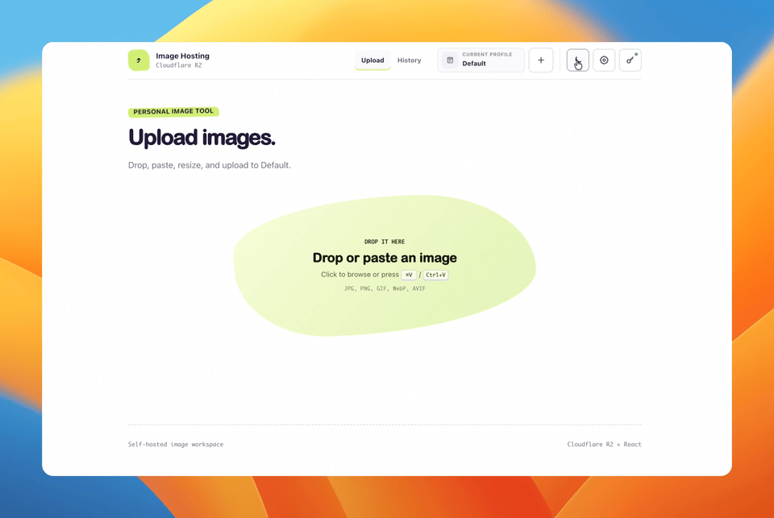

[English](README.md) | [繁體中文](README.zh-TW.md)

<p align="center">
  
  <h1 align="center">R2 Image Hosting</h1>
</p>

<p align="center">
  
  
</p>

一個適合部落格、技術文件與 Markdown 文章使用的小型自架圖片託管工具（圖床）

[線上 Demo](https://image.demo.peiwang.dev/)

> **注意：** 此 Demo 僅供展示，上傳的圖片會在 7 天內刪除


- [Features](#features)
- [Tech Stack](#tech-stack)
- [Supported Images](#supported-images)
- [Run Locally](#run-locally)
  - [Configuration](#configuration)
  - [Deploy](#deploy)
- [API](#api)
- [Multiple Profiles](#multiple-profiles)
- [Commands](#commands)
- [CI 與部署](#ci-與部署)
- [Security and Privacy](#security-and-privacy)
- [License](#license)

可自行 clone 到本機或 deploy 至雲端，將圖片拖曳或貼到頁面，在瀏覽器中提供選項 resize、圖片壓縮、優化成 webp 後上傳至 Cloudflare R2，可複製 Markdown 圖片語法或網址

<p align="center">
  
</p>
## Features

- **React & TypeScript：** 前端由 React & TypeScript 構成
- **上傳：** 拖曳單一檔案，或使用 `Command + V`／`Ctrl + V` 貼上圖片
- **預覽：** 上傳前先確認圖片
- **處理確認：** 比較尺寸、檔案大小、縮放比例、節省空間與處理時間，再進行上傳
- **自訂處理：** 可使用 High、Standard、Fast，或自訂最長邊、WebP 品質與銳化強度
- **流暢處理：** 支援時由 Web Worker 執行縮放、銳化與 WebP 編碼，並保留原生 Canvas fallback
- **自動命名：** 輸入顯示檔名，或產生八字元隨機名稱
- **上傳結果：** 上傳成功後顯示圖片、Markdown 與圖片網址
- **Profiles：** 切換不同 R2 bucket，並透過介面產生新的伺服器端 profile 設定
- **GitHub 登入：** 透過 Cloudflare Access 登入一次，一個月內維持登入；Worker 會在每個管理 API 請求驗證 Access token
- **主題：** 跟隨系統，或選擇亮色／深色模式
- **標籤：** 新增標籤，並依標籤搜尋圖片
- **Gallery 與 List：** 從 Header 切換左右保留 30 px 的滿版 Masonry Gallery，往下捲動時載入更多圖片；或使用置中、最大寬度 900 px 的 List，方便閱讀與操作
- **編輯：** 修改顯示檔名，不改變圖片網址
- **刪除：** 從圖片庫刪除圖片

## Tech Stack

| 技術 | 用途 |
| --- | --- |
| Cloudflare Workers | 提供網站與圖片 API |
| Cloudflare R2 | 儲存上傳圖片 |
| TypeScript | Worker 與 API 程式碼 |
| React、TypeScript、Vite | 瀏覽器介面 |
| Vitest | 自動化測試 |

瀏覽器端執行依賴為 React 與 ReactDOM；圖片處理使用瀏覽器原生 API，不另外加入圖片 codec dependency

pnpm workspace 只包含 `apps/web`、`apps/gateway` 與 `packages/contracts`。Gateway Worker 仍是唯一公開入口，一次部署 Web assets 與 API；Contracts 只保存兩個 app 共用的資料、限制與錯誤格式。

[圖片處理效能測試](docs/image-processing-benchmark.md)

## Supported Images

支援 JPEG、PNG、GIF、WebP 與 AVIF，預設上傳上限為 10 MiB

伺服器會檢查實際檔案特徵，不只信任瀏覽器提供的 MIME type。由於 SVG 可能包含可執行腳本，因此不支援 SVG

## Run Locally

需要 Node.js 22 以上版本，推薦使用 nvm 管理版本

```bash
pnpm install
cp .dev.vars.example .dev.vars
cp wrangler.jsonc.example wrangler.jsonc
```

將 `.dev.vars` 中的 `you@example.com` 改成你的 email，再啟動專案：

```bash
pnpm dev
```

在瀏覽器開啟 [http://127.0.0.1:5173](http://127.0.0.1:5173)。Vite 會將 API 與圖片請求代理到 `8787` port 的本機 Worker

開發期間 Wrangler 使用本機 R2 儲存空間，因此本機上傳不會改動正式環境的 bucket

### Configuration

本機設定放在 `.dev.vars`：

```dotenv
ACCESS_DEV_EMAIL=you@example.com  # 本機登入身分
ACCESS_TEAM_DOMAIN=  # 本機清除 wrangler.jsonc 的正式環境值
CORS_ORIGINS=http://localhost:3000,https://www.example.com  # 限制可呼叫來源
MAX_UPLOAD_BYTES=10485760  # 上傳大小上限
```

Profile 名稱、binding 與公開網址統一在 `wrangler.jsonc` 的 `vars.IMAGE_PROFILES` 中管理。

`ACCESS_DEV_EMAIL` 讓本機請求以該 email 登入，不需 Cloudflare Access 即可執行。Worker 只在請求送往 `localhost`、`127.0.0.1` 或 `[::1]`，且 `ACCESS_TEAM_DOMAIN` 為空時接受它。`.dev.vars` 中的 `ACCESS_TEAM_DOMAIN=` 會在本機清除 `wrangler.jsonc` 的正式環境值；少了這行，已設定的 `wrangler.jsonc` 會啟用 Access 模式，本機 API 會回傳 `503 AUTH_NOT_CONFIGURED`。

正式環境透過 Cloudflare Access 登入，請參考 [設定 Cloudflare Access](#設定-cloudflare-access)。

### 設定 Cloudflare Access

Cloudflare Access 會在 Worker 前加上 GitHub 登入。登入一次後，瀏覽器會保留 Access session 一個月。Worker 也會在每個 `/api/*` 請求驗證 Access token，所以即使某個 hostname 沒有受 Access 保護，也無法呼叫管理 API。

1. 建立 GitHub OAuth app。在 GitHub 前往 **Settings** > **Developer settings** > **OAuth Apps**，選擇 **New OAuth App**。**Homepage URL** 填 `https://<your-team-name>.cloudflareaccess.com`，**Authorization callback URL** 填 `https://<your-team-name>.cloudflareaccess.com/cdn-cgi/access/callback`。複製 **Client ID**，再產生並複製 **Client secret**。
2. 將 GitHub 加為 identity provider。在 Cloudflare dashboard 前往 **Zero Trust** > **Integrations** > **Identity providers**，選擇 **Add new identity provider**，再選 **GitHub**。將 client ID 貼到 **App ID**，secret 貼到 **Client secret**。選擇 **Save**，再選 **Finish setup**。
3. 保護整個 Worker。在 **Workers & Pages** 選擇你的 Worker，前往 **Settings** > **Domains & Routes**，為 `workers.dev` 選擇 **Enable Cloudflare Access**。若 Worker 也有自訂網域，請在 **Zero Trust** > **Access controls** > **Applications** 為該 hostname 建立 self-hosted application。Application 只保留一條 Allow policy，且只包含你的 email，並將 **Session Duration** 設為 1 month。
4. 讓公開路徑維持公開。在 **Zero Trust** > **Access controls** > **Applications** 為同一個 hostname 建立第二個 self-hosted application，路徑填 `images`、`profile-images` 與 `health`。為它加上 action 為 **Bypass**、包含 **Everyone** 的 policy。少了這個 application，指向 Worker 的圖片連結會要求登入，每次部署後的 CI 健康檢查也會失敗。
5. 將設定複製到 `wrangler.jsonc` 的 `vars`。Team domain 位於 **Zero Trust** > **Settings** > **Team name and domain**。AUD tag 是步驟 3 application 的 **Additional settings** 中的 **Application Audience (AUD) Tag**。

   ```jsonc
   "ACCESS_TEAM_DOMAIN": "your-team-name.cloudflareaccess.com",
   "ACCESS_AUD": "your-application-aud-tag",
   "ACCESS_ALLOWED_EMAILS": "you@example.com"
   ```

   `ACCESS_ALLOWED_EMAILS` 以逗號分隔，Worker 比對 email 時不分大小寫。若由 CI 部署，也要更新 `CLOUDFLARE_WRANGLER_CONFIG` secret。

Worker 採 fail closed。若設定了 `ACCESS_TEAM_DOMAIN`，但 `ACCESS_AUD` 為空、`ACCESS_ALLOWED_EMAILS` 沒有任何 email，或同時設定了 `ACCESS_DEV_EMAIL`，所有 `/api/*` 請求都會回傳 `503 AUTH_NOT_CONFIGURED`。簽章錯誤、未知的 key、issuer 或 audience 不符、已過期，或 email 不在清單中的 token 會回傳 `401 UNAUTHORIZED`，訊息會指出失敗的檢查項目。

Access session 過期時，應用程式會重新載入頁面，讓 Access 重新登入。若正在上傳，應用程式改為顯示提示，不會中斷上傳。

既有部署要改用 Access 時，請先完成 Access 設定並部署此版本，再到 Worker 的 **Settings** > **Variables and Secrets** 刪除舊的 Bearer token secret。此版本已不再讀取它。

### Deploy

1. 登入 Cloudflare 並建立 R2 bucket：

   ```bash
   pnpm exec wrangler login
   pnpm exec wrangler r2 bucket create my-images
   ```

2. 如果尚未建立本機部署設定，先複製公開範例：

   ```bash
   cp wrangler.jsonc.example wrangler.jsonc
   ```

   接著修改 `wrangler.jsonc` 中的 placeholder：

   - `name`
   - `r2_buckets[0].bucket_name`
   - `vars.IMAGE_PROFILES[0].label`
   - `vars.IMAGE_PROFILES[0].publicBaseUrl`
   - 若其他瀏覽器來源需要呼叫 API，修改 `vars.CORS_ORIGINS`

3. 為 bucket 連接 R2 自訂網域，再將網址填入 profile 的 `publicBaseUrl`。`r2.dev` 僅用於本機或短期測試，具有流量限制，也不提供正式環境的快取控制。圖片可保存於 edge，但每次重用前會重新驗證，因此刪除物件後不會留下仍在 fresh 狀態的長效副本。

4. 完成 Cloudflare Access 設定並填入 `ACCESS_*` 變數，請參考 [設定 Cloudflare Access](#設定-cloudflare-access)。

5. 部署：

   ```bash
   pnpm deploy
   ```

若 `ACCESS_*` 變數缺少或為空，Worker 仍可部署，但管理 API 會對所有請求回傳 `AUTH_NOT_CONFIGURED`。


## API

| 方法 | 路徑 | 用途 |
| --- | --- | --- |
| `GET` | `/health` | 檢查 Worker 是否正常運作 |
| `GET` | `/api/profiles` | 列出安全的 profile ID 與名稱 |
| `GET` | `/images/:key` | 取得圖片 |
| `GET` | `/profile-images/:profile/:key` | 從其他 profile 取得圖片 |
| `POST` | `/api/images?profile=...` | 上傳圖片 |
| `GET` | `/api/images?profile=...` | 列出圖片並依標籤篩選 |
| `PATCH` | `/api/images?profile=...&key=...` | 更新顯示檔名或標籤 |
| `DELETE` | `/api/images?profile=...&key=...` | 刪除圖片 |

`profile` query 可省略；省略時使用預設 profile。

所有 `/api/*` 路徑都需要 `Cf-Access-Jwt-Assertion` header 中有效的 Cloudflare Access token，登入後由 Access 加上。`/health`、`/images/*` 與 `/profile-images/*` 不需要驗證。


## Multiple Profiles

每個 profile 對應一個 Cloudflare R2 bucket。切換 profile 後，上傳、Gallery／List、搜尋與刪除都會依 bucket 分開

1. 在 Cloudflare 建立 R2 bucket，並啟用公開網址。
2. 在應用程式中選擇 **+**，填寫下列表格欄位。
3. 複製 **R2 bucket binding**，直接貼到 `wrangler.jsonc` 的 `r2_buckets` 陣列中。
4. 複製 **Profile entry**，直接貼到 `vars.IMAGE_PROFILES` 陣列中。
5. 本機測試時重新啟動 Worker；正式環境執行 `pnpm deploy`，再重新整理應用程式。

| 欄位 | 必填 | 填寫內容 | 範例 |
| --- | --- | --- | --- |
| **Profile name** | 是 | 顯示在 profile 切換選單中的名稱，最多 60 個字元。 | `Archive` |
| **Profile ID** | 是 | 1–32 個小寫字母、數字或連字號組成的固定 ID。 | `archive` |
| **R2 bucket name** | 是 | Cloudflare **R2 object storage → Overview** 顯示的完整 bucket 名稱。 | `archive-images` |
| **Worker binding** | 是 | Worker 使用的唯一 JavaScript 變數名稱，建議使用大寫字母與底線。 | `ARCHIVE_IMAGES` |
| **Public image URL** | 是 | **Bucket → Settings → Public access** 中已啟用的網址，不加結尾斜線。 | `https://archive-img.example.com` |

預設 profile 保留 `"id": "default"`。兩個複製欄位都已包含尾逗號，可直接貼入對應陣列；`r2_buckets` 與 `IMAGE_PROFILES` 的 binding 名稱必須完全一致。

## Commands

| 指令 | 用途 |
| --- | --- |
| `pnpm dev` | 啟動 Vite 與本機 Worker |
| `pnpm dev:worker` | 只啟動本機 Worker |
| `pnpm build` | 建置 React 正式環境資源 |
| `pnpm test` | 執行測試 |
| `pnpm lint` | 檢查程式碼格式與規則 |
| `pnpm typecheck` | 檢查 TypeScript 型別 |
| `pnpm check` | 執行 lint、型別檢查、測試與正式建置 |
| `pnpm smoke` | 檢查設定的正式環境 `/health` endpoint |
| `pnpm deploy` | 部署 Worker 至 Cloudflare |

## CI 與部署

Pull request 與推送到 `main` 時，GitHub Actions 會使用專案宣告的 pnpm 版本、`.nvmrc` 的 Node 版本及 frozen lockfile 執行 `pnpm check`。只有 `main` 的檢查成功後，同一個 workflow 才會一起部署 Web assets 與 Gateway Worker。

安裝依賴時也會初始化 Husky pre-push hook，直接執行相同的 `pnpm check`；GitHub CI 仍是最終權威檢查。

請在 GitHub 的 `production` environment 設定以下加密 secrets：

| Secret | 內容 |
| --- | --- |
| `CLOUDFLARE_ACCOUNT_ID` | 擁有此 Worker 的 Cloudflare account ID |
| `CLOUDFLARE_API_TOKEN` | 限制於該帳號、使用 Cloudflare **Edit Cloudflare Workers** policy 的 token |
| `CLOUDFLARE_WRANGLER_CONFIG` | 個人 `wrangler.jsonc` 的完整內容 |
| `SENTRY_AUTH_TOKEN` | 僅授權 CI 上傳 source map 的 Sentry organization token |

Workflow 只會在暫時的 runner 建立 `wrangler.jsonc`；個人設定仍由 Git 忽略，pull request 也無法取得部署 secrets。

另請在同一個 environment 設定以下一般變數：

| Variable | 內容 |
| --- | --- |
| `PRODUCTION_BASE_URL` | 已部署的 Worker 網址，例如 `https://your-worker.workers.dev` |
| `VITE_SENTRY_DSN` | Sentry React project 的公開 browser DSN |
| `SENTRY_ORG` | Sentry organization slug |
| `SENTRY_PROJECT` | Sentry project slug |

部署後，workflow 會在 10 秒 timeout 內請求 `/health`，驗證 HTTP 狀態、service 名稱與健康狀態；若檢查失敗，同一次 Actions 執行仍會保留部署輸出供查找。

正式 Web build 使用 Git commit SHA 作為 Sentry release；source map 會在受保護的 production build 上傳，並於部署 browser assets 前刪除。Browser client 只捕捉 React render crash，不記錄 breadcrumbs、request 資料、使用者資料、local storage、檔名、tags 或 Access token。

需要回復版本時，前往 **Cloudflare → Workers & Pages → 你的 Worker → Deployments**，找到上一個穩定版本，從選單選擇 **Rollback**。也可執行 `pnpm exec wrangler rollback <VERSION_ID> --config wrangler.jsonc --message "Rollback failed deployment"`。Worker rollback 不會回復 R2 物件或其他資源的變更。


## Security and Privacy

- 上傳圖片是公開的。隨機圖片 ID 可降低意外被發現的機率，但不是存取控制。
- 使用只允許此 Worker 寫入的專用 R2 bucket。公開圖片回應會拒絕非圖片 Content-Type。
- Access 會在 session 期間以 `CF_Authorization` cookie 保留登入狀態。在共用電腦上，請前往 Worker hostname 的 `/cdn-cgi/access/logout` 登出
- 不要提交 `.dev.vars`、`.env`、`wrangler.jsonc` 或 `.wrangler/`。`.wrangler/` 可能包含本機 R2 物件與 metadata。
- 請透過 Git 分享專案，不要直接壓縮整個工作目錄，避免包含已忽略的本機檔案。
  
## License

MIT。請參考 [LICENSE](LICENSE)。
